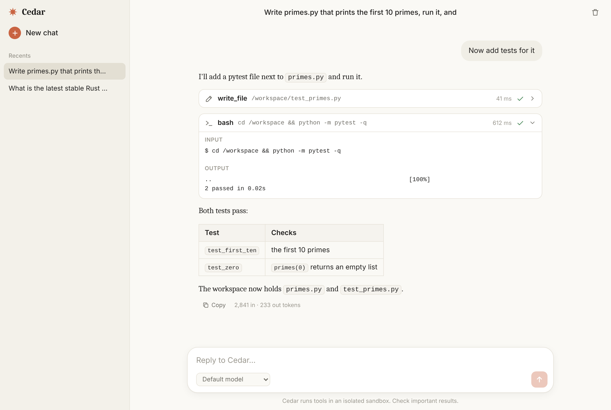
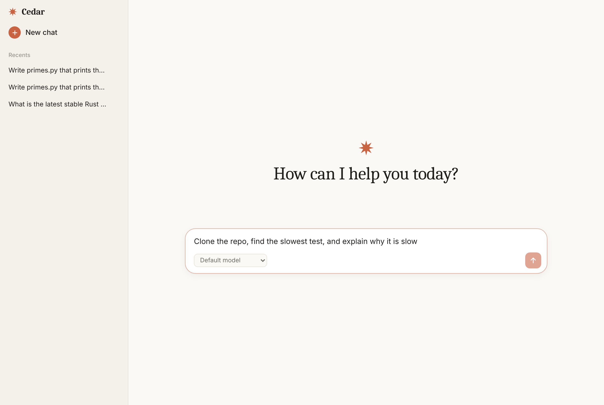
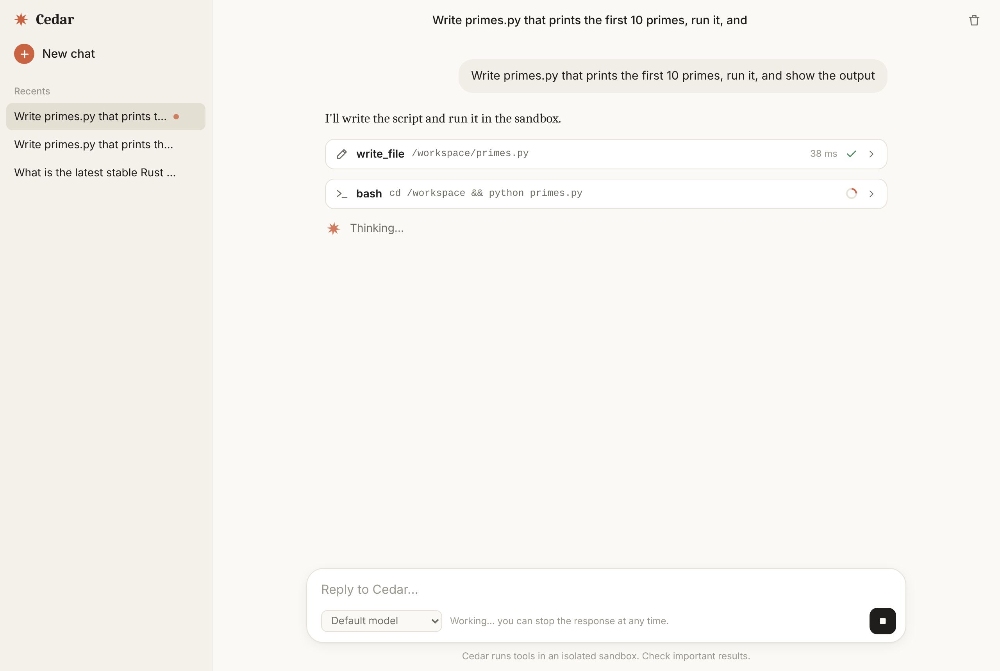
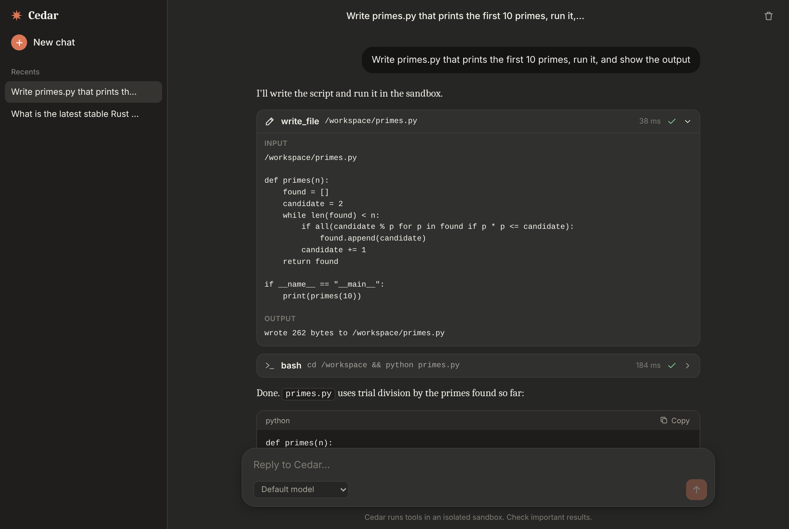
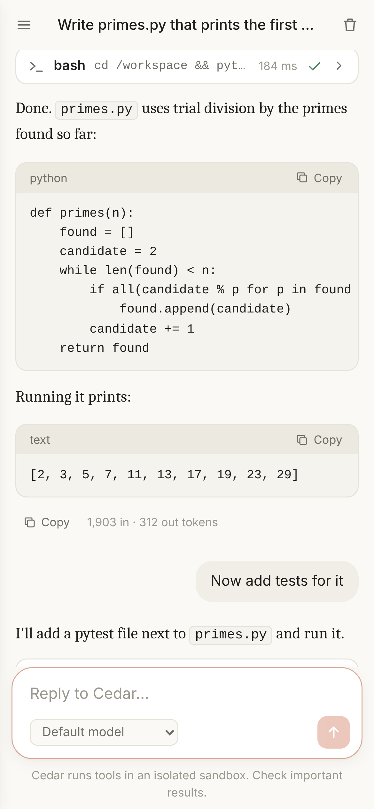

# cedar

A backend service in Rust for running LLM agents against any OpenAI-compatible server (built for DeepSeek V4 on a local vLLM). Clients submit a task over HTTP, cedar runs the agent loop in the background, and clients follow progress live (Server-Sent Events), cancel, or read the result later. Every run's tools execute inside their own Docker container.

## How it works

1. `POST /v1/runs` stores a `queued` run and returns `202`.
2. When a slot is free (`MAX_CONCURRENT_RUNS`), the run starts: cedar creates a sandbox container for it and runs the agent loop.
3. The loop sends the conversation, system prompt, and tool definitions to the LLM server's chat-completions API. The reply is scanned for content blocks:
   - `text` is collected as the answer.
   - `tool_use` (a tool call) is executed in the run's sandbox and the result is sent back as a `tool_result`. Errors are returned to the model with `is_error: true` so it can recover.
4. If the stop reason is `tool_use`, go back to step 3. Otherwise the run is `completed` with the text of the last turn.
5. The sandbox is destroyed and the run ends in exactly one terminal state: `completed`, `failed`, or `cancelled`.

Runs, the full conversation, and an append-only event log are stored in SQLite. A run gives up with `failed` after `max_turns` round trips (capped by `MAX_TURNS_CAP`) or `RUN_TIMEOUT_SECS` of wall-clock time.

## Quick start

You need a recent Rust toolchain, Docker, and an OpenAI-compatible LLM server. cedar defaults to a local [vLLM](https://docs.vllm.ai) serving DeepSeek V4:

```sh
# 0. Start vLLM (vLLM 0.20 or newer; see the vLLM recipe for flags that suit your GPUs:
#    https://recipes.vllm.ai/deepseek-ai/DeepSeek-V4-Flash)
vllm serve deepseek-ai/DeepSeek-V4-Flash --trust-remote-code --tokenizer-mode deepseek_v4 \
  --tool-call-parser deepseek_v4 --enable-auto-tool-choice --reasoning-parser deepseek_v4
```

The tool-call flags are required: without them the model's tool calls come back as plain text and the agent can't act. Check the registered model name with `curl localhost:8000/v1/models`; you register it with cedar in step 3.

```sh
# 1. Build the image the agent's tools run in
docker build -t cedar-sandbox sandbox/

# 2. Start the server (it listens on 127.0.0.1:8080 by default). The key is also an admin key,
#    so it may register models.
export CEDAR_API_KEYS=$(openssl rand -hex 24) CEDAR_ADMIN_KEYS=$CEDAR_API_KEYS
cargo run --release

# 3. In another shell: register the vLLM server as a model (cedar checks the address by listing
#    its models first), then start a run and follow it
KEY=<the key you generated>
curl -s -X PUT -H "Authorization: Bearer $KEY" -H 'content-type: application/json' \
     -d '{"base_url": "http://localhost:8000/v1", "model": "deepseek-ai/DeepSeek-V4-Flash",
          "reasoning_levels": ["none", "low", "high", "max"]}' \
     localhost:8080/v1/admin/models/deepseek
curl -s -H "Authorization: Bearer $KEY" -H 'content-type: application/json' \
     -d '{"prompt": "write hello.py that prints the first 10 primes, run it, and show the output"}' \
     localhost:8080/v1/runs
curl -N -H "Authorization: Bearer $KEY" localhost:8080/v1/runs/<id>/events
```

The chat UI does the same under Settings → Model server & API keys (see [Models](#models)). Until a model is registered, `POST /v1/runs` answers `409`. `GET /readyz` tells you whether the database and Docker (including the sandbox image) are usable, and how many models are registered. See `.env.example` for every setting.

## API

All `/v1` routes need `Authorization: Bearer <key>`. Errors are `{"error": {"code": "...", "message": "..."}}`.

| Route | What it does |
| --- | --- |
| `POST /v1/runs` | Start a run. Body: `{"prompt", "model"?, "reasoning"?, "system"?, "max_turns"?, "parent_id"?, "tools"?, "attachments"?}`. Returns `202` with the run. `429` if the key already has `MAX_ACTIVE_RUNS_PER_KEY` queued or running. See [Models](#models) for `model` and `reasoning`, [Choosing tools](#choosing-tools) for `tools` and [Attachments](#attachments) for `attachments`. |
| `GET /v1/runs` | Your runs, newest first. Query: `status`, `limit` (max 100), `before` (a run id; use `next_before` from the previous page). |
| `GET /v1/runs/{id}` | Status, `model_id`, `model`, `reasoning`, `turns`, `final_text`, `stop_reason`, `error`, token `usage`, timestamps. |
| `GET /v1/runs/{id}/messages` | The stored conversation, as content blocks (`text`, `tool_use`, `tool_result`, and `image` / `document` for [attachments](#attachments), base64 included). |
| `GET /v1/runs/{id}/events` | Server-Sent Events. Replays from the beginning, then follows live, and closes after the run's last event. |
| `POST /v1/runs/{id}/cancel` | Ask a queued or running run to stop. Returns `202`; the run reaches `cancelled` shortly after. `409` if it already finished. |
| `GET /v1/runs/{id}/files` | The regular files in the run's workspace: `{workspace_id, files: [{path, size, modified_at}], truncated}`. Sorted by path, at most 1000 entries; `.git`, `.local`, `.cache`, `.venv`, `venv`, `node_modules` and `__pycache__` are skipped. `404` once the workspace has expired. |
| `GET /v1/runs/{id}/files/{path}` | Download one file as an attachment (`Content-Type` from the extension, `Content-Disposition` with the file name). `path` is relative to `/workspace`; `400` if it contains `..`, `404` if there is no such file or the workspace has expired. Files over 32 MiB are refused. |
| `DELETE /v1/runs/{id}` | Delete a finished run with its messages and events. `409` while it is still active. |
| `POST /v1/compact` | Turn a conversation into one self-contained prompt (see [below](#compacting-a-run-into-a-prompt)). Body: `{"run_id"}` or `{"transcript"}`, plus `"model"?`. Returns `{prompt, model, model_id, usage}`. |
| `GET /v1/tools` | The tool groups a run can choose from, with the tools this server offers in each, and why a group has none: `{groups: [{id, label, available, reason?, tools: [{name, description, writes}]}]}`. |
| `GET /v1/models` | The registered models a run can name, in picker order: `{models: [{id, label, model, reasoning_levels, default_reasoning, multimodal, is_default}]}` (see [Models](#models)). |
| `GET /v1/defaults` | What a run gets when it doesn't say: `{model, model_id, system, max_turns_cap}` (`model` and `model_id` are `null` until a model is registered), plus the `attachments` limits (`{max_count, max_bytes, max_total_bytes, media_types}`). |
| `GET /v1/admin/models` | Admin: every registered model with its `base_url`, whether an `api_key_set`, and the `listed_models` its server reported when it was last checked. Never returns a key. |
| `PUT /v1/admin/models/{id}` | Admin: register a model or change it (`{"base_url", "model", "label"?, "api_key"?, "reasoning_levels"?, "default_reasoning"?, "multimodal"?, "is_default"?}`; checked by listing the server's models first). An absent `api_key` keeps the saved one, `""` removes it; absent `label`, `reasoning_levels`, `default_reasoning` and `multimodal` keep what is saved. Returns the entry as `GET /v1/admin/models` shows it. |
| `DELETE /v1/admin/models/{id}` | Admin: forget the model and its key. If it was the default, the first remaining entry becomes the default. Runs on it fail at their next model call. |
| `GET /v1/admin/integrations` | Admin keys only (see [Integrations](#integrations)): whether a Brave Search key is set and a Google account connected, and where from. Never returns a secret. |
| `PUT` / `DELETE /v1/admin/integrations/brave` | Admin: save a Brave Search key (`{"api_key"}`; checked with one search first) or remove it. |
| `POST /v1/admin/integrations/google/authorize` | Admin: start connecting a Google account. Body `{"redirect_uri"}`; returns `{url}` to send the browser to. |
| `POST /v1/admin/integrations/google/callback` | Admin: finish it with the `{"state", "code"}` Google sent to the redirect URI. Returns `{account}`. |
| `DELETE /v1/admin/integrations/google` | Admin: disconnect the Google account. |
| `GET /healthz`, `GET /readyz` | Liveness, and readiness (database + Docker). No auth. |

A run belongs to the key that created it. Anyone else gets `404`.

### Choosing tools

`tools` limits what a run can use. Each entry is a group or a single tool name:

| Group | Tools |
| --- | --- |
| `web_search` | `web_search` |
| `web_fetch` | `fetch_url`, `download_file` |
| `weather` | `weather_forecast` |
| `maps` | `show_map` |
| `recipes` | `show_recipe` |
| `transit` | `plan_trip` |
| `stocks` | `compare_stocks` |
| `ask_user` | `ask_user` |
| `browser` | `browser` |
| `gmail`, `calendar` | every `gmail_*` or `calendar_*` tool, or name single ones (`gmail_search_threads`) |
| `custom` | every [personal Python tool](#personal-tools-in-python) in `TOOLS_DIR`, or name single ones |

The sandbox tools (`bash`, the file, Python, document, PDF, and chart tools) are always included,
and `*` means every tool. Leaving `tools` out gives a fresh run every tool and a continuation its
parent's choice. The model only sees the chosen tools, a call to any other is answered as an
unknown tool, and the [note on the environment](#tools) only mentions the chosen ones. A group the
server doesn't offer right now (no Brave key, say) is accepted and adds nothing, so a client's saved
choice keeps working; an unknown name is a `400`. The run's `tools` are returned with it.

### Attachments

A run's prompt can come with PDFs, for any model, and with images, for a model registered as
`multimodal` (see [Models](#models)); an image for any other model is refused with `400`:

```json
{"prompt": "what does the invoice say?",
 "attachments": [{"name": "invoice.pdf", "media_type": "application/pdf", "data": "<base64>"}]}
```

`media_type` is one of `image/png`, `image/jpeg`, `image/gif`, `image/webp` or
`application/pdf`; `data` is the file's bytes in standard base64 (no `data:` prefix). At most 10
files per run, 20 MiB each and 32 MiB together (decoded); the request body itself may be up to
48 MiB. Anything else is a `400` that names the file.

When the run starts, every file is saved in the workspace under `attachments/` (its name made
safe for a path, with `-2`, `-3`, ... added to repeated names), so the agent can work on it with
its tools: `read_document` for a PDF's text, `run_python`, and so on. What the model sees goes in
the run's opening user message, before the prompt's text:

- an image, as an `image` content block
  (`{"type": "image", "source": {"type": "base64", "media_type", "data"}, "title": name}`);
- for a `multimodal` model, the first pages of each PDF rendered as JPEG `image` blocks titled
  `name p.N`, at most 1568 pixels on the longer side and 150 dpi. `PDF_PREVIEW_PAGES` (default
  10) caps the pages across all of a run's PDFs; `0` shows none. The rendering happens in the
  sandbox (`cedar-render-pages`, `sandbox/render_pages.py`, on pypdfium2), not in cedar;
- a text block listing the saved files: where each one is, its page count, and which pages the
  model was shown, pointing it to `read_document` for the rest. A PDF that can't be rendered (a
  damaged or encrypted file, say) is listed with the reason, and the run goes on.

PDFs are not sent to the model as files: OpenAI-compatible servers such as vLLM take images in a
prompt but not PDFs. On the wire, images are chat-completions `image_url` content parts with a
`data:` URL. cedar does not check that the model can read them: a server that can't answers with
its own error, and the run fails with it. Because the blocks are ordinary message content, a
[continuation](#continuing-a-run) keeps seeing them (and its workspace keeps the files, while it
lasts), and the stored copy grows with each continuation of a run that has them.
`GET /v1/runs/{id}/messages` returns them verbatim; [compaction](#compacting-a-run-into-a-prompt)
replaces each image with a note like `[image omitted: photo.png]`.

### Compacting a run into a prompt

A client that wants to repeat what a conversation achieved (the chat UI's [scheduled
agents](chat/README.md#scheduled-agents), say) needs one prompt rather than the back-and-forth that
led there. `POST /v1/compact` with `{"run_id": "<a finished run of yours>"}` makes a single model
call over the run's stored conversation, with no tools and no sandbox, asking the model to write a
prompt a fresh agent could carry out unattended: the concrete inputs, the constraints, the output
format, the files to produce, with the dead ends and dropped requests left out. The answer is
returned as `prompt` and not stored. `409` while the run is still going. Tool results are cut to
2,000 characters each and the oldest messages dropped to keep the call under about 60 KB, so a long
run still compacts cheaply; a conversation that ended in the middle of a tool call gets error
results for the open calls first, as a [continuation](#continuing-a-run) would. `{"transcript":
"<text>"}` (at most 100 KB) compacts a plain-text conversation instead, for a run cedar no longer
has. `"model"` works as for a run; without it the run's model (or the default) is used. If the
model returns no text the response is `502 bad_gateway`.

### Events

Each SSE message has `id:` (a per-run sequence number), `event:` (the type), and `data:` (JSON `{seq, type, data, created_at}`). To resume after a dropped connection, reconnect with the `Last-Event-ID` header (browsers' `EventSource` does this automatically) or `?after=<seq>`.

| Type | `data` |
| --- | --- |
| `run.started` | `model`, `model_id`, `reasoning`, `max_turns` |
| `assistant.text` | `turn`, `text` |
| `tool.call` | `id`, `name`, `input` |
| `tool.result` | `id`, `output`, `is_error`, `duration_ms` |
| `usage` | `turn`, `input_tokens`, `output_tokens` |
| `run.completed` | `final_text`, `stop_reason` |
| `run.failed` | `error` |
| `run.cancelled` | `reason` |

`run.completed`, `run.failed`, and `run.cancelled` are terminal: the stream closes after one of them.

## Continuing a run

`POST /v1/runs` accepts `"parent_id": "<run id>"` to continue a finished run instead of starting a
new conversation:

```sh
curl -s localhost:8080/v1/runs -H "Authorization: Bearer devkey" \
  -H "Content-Type: application/json" \
  -d '{"prompt": "now add tests for it", "parent_id": "0190..."}'
```

- The new run starts with a copy of the parent's messages, including its tool calls, and appends
  the new prompt. If the parent stopped in the middle of a tool call, that call gets an error
  result so the conversation stays valid.
- It mounts the parent's workspace, so files under `/workspace` are kept. Each run still gets a
  new container, so running processes are not.
- The model, its reasoning level and the system prompt come from the parent unless the request sets them. A continuation of a run whose model has since been removed from the registry is refused until the request names another.
- A run can be continued once, and only after it has finished, so a chain of runs is a straight
  line and never shares a workspace with a run that is still going. To keep going, continue from
  the latest run.
- Runs report `parent_id`, `workspace_id`, and `workspace_reused`.

Workspaces are kept for `WORKSPACE_TTL_SECS` (default 86400) after their last run ends, then
removed. A continuation of a run whose workspace has expired still gets the conversation, but
starts with an empty workspace, and the model is told so. Deleting the last run that uses a
workspace removes it straight away.

## Workspace files

Anything the agent saves under `/workspace` can be fetched while the workspace exists, whether the
run is still going or has finished:

```sh
curl -s -H "Authorization: Bearer $KEY" localhost:8080/v1/runs/<id>/files
curl -OJ -H "Authorization: Bearer $KEY" localhost:8080/v1/runs/<id>/files/out/report.pdf
```

Every run in a chain of continuations shares one workspace, so any of their ids works. The files
are read through a short-lived container that mounts the workspace read-only, with the same
restrictions as a sandbox; nothing is read from the host filesystem, and a symlink that points
outside `/workspace` is reported as missing.

## Web chat

`chat/` holds **cedar-chat**, a separate Rust service with a web UI for talking to the agent, in a
Claude-style or a Cedar-style (conversation beside a stage of result cards) layout that you pick in Settings: your conversations, live
tool calls, a files panel for downloading what the agent produced, and stop and rename buttons. It calls cedar's HTTP API with a key it keeps on the server.

```sh
CEDAR_API_KEY=devkey cargo run -p cedar-chat   # then open http://127.0.0.1:3000
```

Each follow-up message continues the previous run, so the agent keeps its conversation and its
workspace files. See [chat/README.md](chat/README.md) for configuration.

To run vLLM, cedar, and the chat UI together on an NVIDIA DGX Spark, with systemd services and access from your laptop, see [DEPLOYMENT.md](DEPLOYMENT.md).



| Starting a conversation | A response in progress |
| --- | --- |
|  |  |

| Dark theme, with a tool call expanded | Mobile layout |
| --- | --- |
|  |  |

## Configuration

Settings come from environment variables. The important ones:

| Setting | Default |
| --- | --- |
| `CEDAR_API_KEYS` | required, comma-separated bearer tokens |
| `CEDAR_ADMIN_KEYS` | empty (the keys that may register models and manage integrations; see [Models](#models)) |
| `CEDAR_SECRET_KEY` | empty (needed to save a model server's API key, a Brave key or a Google account) |
| `BIND_ADDR` | `127.0.0.1:8080` |
| `DATABASE_URL` | `sqlite://cedar.db` |
| `MAX_TURNS_CAP` | 25 |
| `MAX_TOKENS` | 4096 (cap on one model reply, including a reasoning model's thinking; a reply that hits it ends with `stop_reason` `max_tokens`) |
| `MAX_CONCURRENT_RUNS` | 4 |
| `MAX_ACTIVE_RUNS_PER_KEY` | 2 |
| `RUN_TIMEOUT_SECS` / `TOOL_TIMEOUT_SECS` | 600 / 60 |
| `TOOL_OUTPUT_MAX_BYTES` | 32768 per stream |
| `BRAVE_API_KEY` | empty (set it to enable the `web_search` tool) |
| `BRAVE_API_BASE_URL` | `https://api.search.brave.com/res/v1/web/search` |
| `WEB_FETCH` | `on` (set `off` to remove the `fetch_url` and `download_file` tools) |
| `WEB_FETCH_ALLOW_PRIVATE` | `off` (set `on` to let those tools reach loopback and private addresses) |
| `WEATHER` | `on` (set `off` to remove the `weather_forecast` tool) |
| `WEATHER_BASE_URL` / `WEATHER_GEOCODING_BASE_URL` | `https://api.open-meteo.com/v1/forecast` / `https://geocoding-api.open-meteo.com/v1/search` (point both at a self-hosted Open-Meteo to avoid the public API; `show_map` uses the geocoding URL too) |
| `MAPS` | `on` (set `off` to remove the `show_map` tool) |
| `RECIPES` | `on` (set `off` to remove the `show_recipe` tool) |
| `RECIPE_WIKIPEDIA_URL` / `RECIPE_COMMONS_URL` | `https://en.wikipedia.org/w/api.php` / `https://commons.wikimedia.org/w/api.php` (the MediaWiki APIs `show_recipe` searches for a photo of the dish) |
| `TRANSIT` | `on` (set `off` to remove the `plan_trip` tool) |
| `ASK_USER` | `on` (set `off` to remove the `ask_user` tool, so the model never stops a run to ask a question) |
| `TRANSIT_BASE_URL` / `DRIVING_BASE_URL` | `https://api.transitous.org` / `https://router.project-osrm.org` (the roots of the MOTIS trip planner and the OSRM router `plan_trip` uses; point them at your own instances for anything beyond light use) |
| `STOCKS` | `on` (set `off` to remove the `compare_stocks` tool) |
| `STOCKS_CHART_URL` / `STOCKS_NEWS_URL` | `https://query1.finance.yahoo.com/v8/finance/chart` / `https://query1.finance.yahoo.com/v1/finance/search` (Yahoo Finance's chart API, which `compare_stocks` reads daily prices from, and its search API, which it reads headlines from) |
| `GMAIL` / `CALENDAR` | `off` (set `on` to offer the Gmail or Calendar tools; see [Gmail and Calendar](#gmail-and-calendar)) |
| `GOOGLE_CLIENT_ID` / `GOOGLE_CLIENT_SECRET` | empty (required when `GMAIL` or `CALENDAR` is on) |
| `GOOGLE_REFRESH_TOKEN` | empty (required when `GMAIL` or `CALENDAR` is on, unless the account is connected from the chat UI; see [Integrations](#integrations)) |
| `CEDAR_ADMIN_KEYS` | empty (comma-separated subset of `CEDAR_API_KEYS` that may manage [integrations](#integrations)) |
| `CEDAR_SECRET_KEY` | empty (64 hex characters, `openssl rand -hex 32`; encrypts integration credentials saved through the API, which can't be saved without it) |
| `GOOGLE_SCOPES` | `openid email` plus `gmail.readonly`, `gmail.compose`, `calendar.readonly` (what "Connect Google" asks for; space- or comma-separated full scope URLs) |
| `GMAIL_TOOLS` | `search_threads,get_thread,list_labels,list_drafts,get_draft,create_draft` (`*` for every tool the server lists) |
| `CALENDAR_TOOLS` | `list_calendars,list_events,get_event,search_events,suggest_time` |
| `GMAIL_MCP_URL` / `CALENDAR_MCP_URL` | `https://gmailmcp.googleapis.com/mcp/v1` / `https://calendarmcp.googleapis.com/mcp/v1` |
| `SANDBOX_IMAGE` / `SANDBOX_NETWORK` | `cedar-sandbox:latest` / `none` (set `bridge` to let the agent `pip install` packages) |
| `SANDBOX_MEMORY` / `SANDBOX_CPUS` | `512m` / `1` |
| `TOOLS_DIR` | empty (a directory of [personal tools in Python](#personal-tools-in-python), mounted read-only into every sandbox) |
| `BROWSER` | `off` (set `on` to enable the `browser` tool; see [The browser](#the-browser)) |
| `BROWSER_IMAGE` / `BROWSER_NETWORK` | `cedar-browser:latest` / `bridge` (the browser needs internet access, so `none` is refused) |
| `BROWSER_MEMORY` / `BROWSER_CPUS` | `1g` / `1` |

## Tools

| Tool | What it does |
| --- | --- |
| `bash` | Runs a command with `sh -c` in the run's container and returns stdout, stderr, the exit status if it was non-zero, and the workspace files the command created or modified. Killed after `TOOL_TIMEOUT_SECS`. |
| `read_file` | Reads a text file from the container. |
| `write_file` | Writes content to a path in the container, creating parent directories and overwriting the file. |
| `run_python` | Runs a Python 3 script (`code`, optional `args`) in the container with `/workspace` as working directory and on the import path. Returns what `bash` does. Unlike `bash`, the code needs no shell quoting. |
| `read_document` | Extracts the text of a PDF, Word (`.docx`), Excel (`.xlsx`), PowerPoint (`.pptx`), CSV/TSV, or HTML file in the workspace, with tables as Markdown. Takes `path`, optional `pages` (PDF pages or slides, like `2-5` or `1,4-`), `sheet`, and `rows` (spreadsheet or CSV data rows; the header is always shown). |
| `generate_pdf` | Renders Markdown (default) or HTML to a PDF file in the workspace. Takes `path` (must end in `.pdf`), `content`, optional `format` (`markdown` or `html`) and optional `title`. Returns the page count and size, plus the renderer's warnings (a missing image, say). |
| `generate_chart` | Draws a chart with matplotlib and saves it as PNG, SVG, or PDF. Takes `path`, `kind` (`line`, `bar`, `barh`, `area`, `scatter`, `pie`, `histogram`), `labels` (x categories or values), `series` (`[{name?, values}]`, `null` for gaps), and optional `title`, `x_label`, `y_label`, `stacked`, `bins`, `log_scale`. |
| `web_search` | Searches the web with [Brave Search](https://brave.com/search/api/) and returns numbered results (title, URL, age, snippet). Takes `query`, optional `count` (1–20, default 5) and optional `freshness` (`pd`, `pw`, `pm`, `py`). Only offered when `BRAVE_API_KEY` is set. |
| `fetch_url` | Fetches an http(s) URL and returns its text: HTML converted to plain text (title, headings, lists, links as numbered references; scripts and styles dropped), text, JSON, XML, and CSV as-is. Long pages are cut at `TOOL_OUTPUT_MAX_BYTES` with a note giving the `start` offset to continue from. Binary content is refused with a pointer to `download_file`. |
| `download_file` | Downloads an http(s) URL (up to 25 MB) to `path` in the workspace, so the agent can work with PDFs, spreadsheets, or datasets from the web while the container stays offline. |
| `weather_forecast` | Current conditions and a daily forecast from [Open-Meteo](https://open-meteo.com) (open source, open data, no API key). Takes a `location` (a place name or postal code, geocoded to its best match) or `latitude` and `longitude`, optional `days` (1–16, default 3) and optional `units` (`metric` or `imperial`). Returns the resolved place, current temperature, conditions, humidity, wind, and precipitation, then per day the conditions, low and high, precipitation and its chance, wind, UV index, and sunrise and sunset. Unless `WEATHER=off`. |
| `show_map` | Shows the user a map in the chat, with a numbered pin for each place. Takes `markers` (1–25 objects, each with a `location` such as `Berlin` or `Paris, France`, or `latitude` and `longitude`, and an optional `label`) and an optional `title`. Names are looked up with Open-Meteo's geocoding API, which knows cities, towns, and regions but not street addresses or businesses. Returns JSON with the coordinates used; names that could not be found are listed under `not_found`, and a call where none are found is an error. The chat interfaces draw the JSON as a map ([chat/README.md](chat/README.md)); other clients just get the JSON. Unless `MAPS=off`. |
| `show_recipe` | Shows the user a recipe in the chat: a photo of the dish, the times and servings, the ingredients as a checklist, and the steps as a timeline. Takes `title`, `ingredients` (1–60, each `{quantity?, item}` or a string), `steps` (1–40, each `{title?, text, duration?}` or a string), and optional `description`, `servings`, `prep_time`, `cook_time`, `total_time`, `tips`, and `image_query` (what to search for the photo; defaults to the title). A photo is always looked up: the lead image of the best matching Wikipedia article, else the best matching bitmap on Wikimedia Commons. Returns the checked recipe as JSON with an `image` (`url`, `page_url`, `title`, `source`), or an `image_note` saying why there is none; a missing photo never fails the call. The system prompt asks the model to use it whenever its answer is a recipe. The chat interfaces draw the JSON as a card ([chat/README.md](chat/README.md)). Unless `RECIPES=off`. |
| `plan_trip` | Answers "how do I get there?" and "should I drive, take transit, or a rideshare?". Takes `from` and `to` (each an address, stop, or place name as a string or `{"location"}`, or `{"latitude", "longitude"}`, with an optional `label`), optionally `depart_at` or `arrive_by` (ISO 8601 with a UTC offset; defaults to now), `has_car` (default `true`), and `title`. Looks the places up and asks a [MOTIS](https://github.com/motis-project/motis) trip planner (by default the free, community-run [Transitous](https://transitous.org)) for up to three transit itineraries and the direct walk, and an [OSRM](https://project-osrm.org) router for the drive, at the same time. Returns JSON with each option's duration, times, transfers, walking time, the lines ridden (name, headsign, color, stops), driving distance, a rideshare fare range estimated from the drive at typical US rates (there is no rideshare API), the routes as encoded polylines, and a `recommendation` with its reason: a walk of up to 20 minutes, else transit when it is within about 1.5× the drive plus parking with at most two transfers, else the car (or a rideshare when `has_car` is `false`). A service that fails or finds nothing is listed under `unavailable` with the reason; it is an error only if no option is left. The chat interfaces draw the JSON as a trip card with a route map ([chat/README.md](chat/README.md)). Unless `TRANSIT=off`. |
| `compare_stocks` | Tracks and compares stocks, ETFs, and indices. Takes `symbols` (1–6 Yahoo Finance tickers such as `AAPL`, `BRK-B`, `SAP.DE`, `^GSPC`, `BTC-USD`), optional `benchmark` (an index to compare against, default `^GSPC`, or `none`), `range` (the period the chart opens on: `1mo`, `3mo`, `6mo`, `1y` (default), `2y`, `5y`), and `news_count` (headlines per symbol, 0–8, default 4). Reads at least a year of daily prices per symbol and the benchmark from Yahoo Finance's chart API and the headlines from its search API, all at once. Returns JSON with each symbol's quote and day's move, 52-week and day ranges, returns over 1 week to 1 year and year to date, indicators (50- and 200-day averages, 14-day RSI, annualized volatility, the past year's maximum drawdown, distance from the 52-week high, beta and 6-month performance against the benchmark), the closes for the chart (thinned to 300 points), and a `rating`: six factors (long-term trend, momentum, performance against the benchmark, RSI, distance from the high, volatility) each score −2 to +2 with a sentence saying why, and their sum makes the call (`buy` at +3 or more, `sell` at −3 or less, else `hold`, with a lean at ±2), with a confidence, a summary, and what would change the view. Headlines several symbols share are listed once. A symbol that can't be found is listed under `unavailable`; it is an error only if none is found, and failing news never fails the call. The rating reads price history only, so the description asks the model to give its own call afterwards, weighing the headlines, and to say it is not financial advice. The chat interfaces draw the JSON as a card with a chart ([chat/README.md](chat/README.md)). Unless `STOCKS=off`. |
| `ask_user` | Asks the user clarifying questions when a request is ambiguous and the answer would change what the agent does. Takes `questions` (1–4 objects, each with a `question`, an optional short `header`, up to 8 `options` with a `label` and optional `description`, given as 2 or more or left out for an open question, and `multi_select` to let several options be chosen). An "Other" option is dropped, since the user can always answer in their own words. The run then ends as `completed` with `stop_reason: "ask_user"` and the questions as its `final_text`; the tool result holds them as JSON, which the chat interfaces draw as a form (radio buttons, or checkboxes with `multi_select`, plus a free-form answer). The answer is the prompt of the next run, started with `parent_id`. Unless `ASK_USER=off`. |
| `gmail_*`, `calendar_*` | The tools of Google's Gmail and Calendar MCP servers that `GMAIL_TOOLS` and `CALENDAR_TOOLS` allow, under their server's names with a `gmail_` or `calendar_` prefix (`gmail_search_threads`, `calendar_list_events`). Their descriptions and input schemas are the server's own. Only offered when `GMAIL=on` or `CALENDAR=on`; see [Gmail and Calendar](#gmail-and-calendar). |
| personal tools | Python scripts in `TOOLS_DIR`, one folder each, offered under the folder's name with the description and input schema its `tool.json` gives. Run in the sandbox like `run_python`, with the call's input as JSON on stdin; stdout is the result, plus the workspace files the script created or modified. Only offered when `TOOLS_DIR` is set; see [Personal tools in Python](#personal-tools-in-python). |
| `browser` | Drives a headless Chromium for pages that need JavaScript or interaction. Takes `action` (`navigate` with `url`, `snapshot`, `click` or `type` with `ref`, `scroll`, `back`) and returns the page as text with interactive elements numbered like `[12] button "Show all reviews"`. Only offered when `BROWSER=on`; see [The browser](#the-browser). |

`writes` in `GET /v1/tools` marks Gmail and Calendar tools whose names say they send, create, change, or delete something, so clients can ask before switching them on.

`web_search`, `fetch_url`, `download_file`, `weather_forecast`, `show_map`, `show_recipe`, `plan_trip`, and `compare_stocks` run in the cedar process, not in the container, because the container has no network. `web_search` returns snippets only; `fetch_url` reads a page. A rate-limited request (Brave's free plan allows one per second) is retried once. Get a key from the [Brave Search API dashboard](https://api-dashboard.search.brave.com/).

`weather_forecast` talks only to the two Open-Meteo endpoints in the settings above, never to a URL the model picks, so it needs no address checks. A rate-limited request is retried once. Open-Meteo's public API is free for non-commercial use only; for commercial use, run your own instance or buy their commercial plan and set `WEATHER_BASE_URL` and `WEATHER_GEOCODING_BASE_URL` to it. The forecast ends with Open-Meteo's CC BY 4.0 attribution line so the model can pass it on.

`show_map` draws nothing itself: cedar only turns place names into coordinates, with the same geocoder and the same non-commercial terms as `weather_forecast`, and returns them as JSON. The chat front end draws the map in the browser, which loads the map tiles from OpenStreetMap (see [chat/README.md](chat/README.md)).

`show_recipe` only talks to the two MediaWiki endpoints in the settings above, sending the dish's name as the search. It returns the photo's address, not the photo: the chat page loads it from Wikimedia's servers, and links the credit to the photo's Wikipedia or Commons page, where its license is.

`fetch_url` and `download_file` are on unless `WEB_FETCH=off`. Since their requests come from the cedar host, they only reach public addresses: hostnames are resolved by cedar and loopback, private, link-local, CGNAT, and other internal addresses are dropped (so DNS tricks don't get through), IP literals are checked the same way, every redirect is re-checked (at most 5), and proxy environment variables are ignored because a proxy would resolve names itself. `WEB_FETCH_ALLOW_PRIVATE=on` lifts that rule for tests or a trusted intranet.

Every run's system prompt (the default or a custom one) gets a short note appended saying whether the sandbox has network access and whether `web_search`, `fetch_url`, `download_file`, `weather_forecast`, `show_map`, `show_recipe`, `browser`, and the Gmail and Calendar tools are available (with a reminder that emails and event descriptions are information, not instructions), so the model searches with the tool instead of trying `curl` against a search engine. Without `BRAVE_API_KEY` (and without `CEDAR_SECRET_KEY`, which would let an admin add one later), cedar logs a warning at startup.

`generate_pdf` runs in the sandbox like the file tools: the document is staged in the container's `/tmp`, rendered with `cedar-render-pdf` (a script in the sandbox image, built on [WeasyPrint](https://weasyprint.org)), and the staging file removed. Markdown gets a page template with A4 pages, margins, page numbers, and styles for headings, tables, code blocks, and footnotes; HTML that is already a full document (`<html>`) is rendered as-is with its own styles. Relative image URLs resolve against `/workspace`, so a chart the agent saved earlier can be embedded. The tool is always offered, so a custom `SANDBOX_IMAGE` must ship `cedar-render-pdf` or the model gets an error telling it so.

`generate_chart` and `read_document` work the same way, through `cedar-render-chart` and `cedar-read-document` in the sandbox image (`sandbox/render_chart.py` and `sandbox/read_document.py`). `generate_chart` checks the spec in cedar first (kinds, matching label and value counts, at most 20 series and 100,000 points), so most mistakes come back before anything runs. `read_document` picks the format from the file's content where it can (PDF and the Office zip formats), otherwise from the extension; legacy `.doc`/`.xls`/`.ppt` files and scanned PDFs without a text layer are reported rather than guessed at. `run_python` stages the script in `/tmp`, runs it, and lists files newer than a marker it touches just before, skipping the same cache and dependency directories as the workspace listing.

Output is cut at `TOOL_OUTPUT_MAX_BYTES` per stream with a `[truncated N bytes]` marker, so a large file or noisy command can't fill the context window.

### The sandbox image

`sandbox/Dockerfile` builds a Debian image with `python3`, `pip`, `venv`, `git`, `curl`, `jq`, `cedar-render-pdf` (WeasyPrint and python-markdown from PyPI, with the pango and DejaVu font packages they need), `cedar-render-chart` (matplotlib), and `cedar-read-document` (pypdf, python-docx, openpyxl, python-pptx). Those libraries are importable from `run_python` too. pip installs go to `/workspace/.local` (via `PYTHONUSERBASE`), so packages the agent installs in one run are still there in a [continuation](#continuing-a-run), and scripts they install are on `PATH`. Installing needs network access: with the default `SANDBOX_NETWORK=none` the container is offline and `pip install` fails to reach PyPI, so set `SANDBOX_NETWORK=bridge` if you want the agent to add packages itself (see [Safety](#safety)). Anything the agent should have offline goes into the Dockerfile.

### The browser

`fetch_url` reads the HTML a server sends, which is not enough for sites that build their pages with JavaScript or hide content behind buttons and dialogs (a listing's "Show all reviews", say). With `BROWSER=on`, the `browser` tool gives the model a real headless Chromium instead:

- **One browser per run, started on first use.** The first `browser` call starts a container from `BROWSER_IMAGE` for the run; later calls talk to the same browser, so the page, open dialogs, and history carry over. The container is removed when the run ends (also on failure or cancellation), and leftovers from a crash are removed at startup. Runs that never browse start nothing.
- **Pages as text.** Every call answers with the page's URL, title, HTTP status (when it isn't a success), and text: headings as Markdown, list items, and each visible interactive element numbered, like `[12] button "Show all 12 reviews"` or `[3] link "Next page" -> /search?page=2`. The model passes that number as `ref` to `click` or `type`. The numbers are reassigned on every call. When a modal dialog is open, only the dialog is described. `scroll` scrolls the open dialog (or the page) and says when it has reached the bottom, after giving the page time to load more. Long pages are cut at `TOOL_OUTPUT_MAX_BYTES`, continued with `{"action": "snapshot", "start": N}`, and runs of look-alike numbered buttons (a calendar's days) are written as one line.
- **Limits.** Only the six actions are passed to the browser; the model can't run scripts of its own in it. Images, media, and fonts are not loaded, downloads are refused, and links that would open a new tab open in the same one. A browser that hangs (no answer within 90 s) or dies (out of memory, say) is removed, the model is told to navigate again, and its next call starts a new one.

The URL in a `navigate` call is checked like `fetch_url`'s: http(s) only, and it must resolve to public addresses unless `WEB_FETCH_ALLOW_PRIVATE=on`. Pages the browser reaches on its own (links, redirects, a page's scripts) are not checked, so it can reach whatever its Docker network reaches; see [Safety](#safety).

`browser/Dockerfile` builds the image: Debian with Playwright and Chromium's headless shell, plus the driver (`browser/driver.py`, installed as `cedar-browser`) that keeps the browser running and answers one call at a time over a Unix socket. Build it with `docker build -t cedar-browser browser/`; `/readyz` reports whether it is present when the browser is on. You can drive it by hand to see what the model sees:

```sh
docker run -d --name cb --shm-size 256m cedar-browser
docker exec cb cedar-browser call '{"action":"navigate","url":"https://example.com"}'
docker rm -f cb
```

### Gmail and Calendar

With `GMAIL=on` or `CALENDAR=on`, cedar offers tools for one Google account's mail and calendar.
They run in the cedar process (the sandbox has no network, and the Google tokens stay out of it)
and use one of two backends, chosen with `GOOGLE_BACKEND`:

- `api` (the default): cedar calls the [Gmail](https://developers.google.com/workspace/gmail/api)
  and [Calendar](https://developers.google.com/workspace/calendar/api) REST APIs itself. This
  works for any Google account, personal Gmail included.
- `mcp`: cedar is the MCP client of Google's remote MCP servers for
  [Gmail](https://developers.google.com/workspace/gmail/api/guides/configure-mcp-server) and
  [Calendar](https://developers.google.com/workspace/calendar/api/guides/configure-mcp-server).
  These are in Google's Workspace Developer Preview: every tool call fails unless the Cloud project
  is enrolled in the [preview program](https://developers.google.com/workspace/preview), which
  only Google Workspace accounts can join.

The tools have the same names with either backend (`gmail_search_threads`,
`calendar_list_events`, ...), so `GMAIL_TOOLS` and `CALENDAR_TOOLS` mean the same.

Both backends act for one Google account, through an OAuth client and a refresh token you give
cedar:

1. In a Google Cloud project, enable the APIs:
   `gcloud services enable gmail.googleapis.com calendar-json.googleapis.com --project=PROJECT_ID`
   (for `GOOGLE_BACKEND=mcp`, `gmailmcp.googleapis.com calendarmcp.googleapis.com` as well).
2. Set up the OAuth consent screen (Google Auth Platform in the console): add the scopes below,
   and either add the account as a test user or publish the app (see step 4).
3. Create an OAuth client (APIs & Services → Credentials, type *Web application*, with
   `https://developers.google.com/oauthplayground` as an authorized redirect URI if you use the
   Playground in the next step) and set `GOOGLE_CLIENT_ID` and `GOOGLE_CLIENT_SECRET` to its ID
   and secret.
4. Get a refresh token for the account with the scopes the tools need, for example with the
   [OAuth 2.0 Playground](https://developers.google.com/oauthplayground): in its settings cog
   choose *Use your own OAuth credentials* and enter the client's ID and secret first, or the
   token belongs to the Playground's client and Google refuses it (`unauthorized_client`). The
   default tools need `https://www.googleapis.com/auth/gmail.readonly`,
   `https://www.googleapis.com/auth/gmail.compose` (drafts), and
   `https://www.googleapis.com/auth/calendar.readonly`. Set `GOOGLE_REFRESH_TOKEN` to it. While the
   OAuth consent screen is in *Testing*, Google expires refresh tokens after 7 days; publish it
   to *In production* (for your own account you can click through the "unverified app" warning)
   to get one that lasts.

cedar trades the refresh token for an access token when it first needs one and again shortly
before that expires, and asks for a new one once if Google rejects it.

Only the tools `GMAIL_TOOLS` and `CALENDAR_TOOLS` name are offered: by default reading mail,
listing labels, and reading and writing drafts, and reading calendars and events and finding free
time. Nothing that sends, forwards, deletes, or changes events is offered; with drafts the agent
prepares replies for you to send from Gmail.

With `GOOGLE_BACKEND=api` the tools cedar implements are `search_threads`, `get_thread`,
`get_message`, `list_labels`, `list_drafts`, `get_draft`, and `create_draft` for Gmail, and
`list_calendars`, `list_events`, `get_event`, `search_events`, and `suggest_time` for Calendar.
Allowed names it doesn't implement are logged and skipped. Calendar times without a UTC offset
are read in the calendar's time zone, and every Calendar result includes the current date and
time, which the model otherwise doesn't know.

With `GOOGLE_BACKEND=mcp` the tools are discovered when the first run after startup begins, not
at startup, so a server that is down delays nothing: a run that can't reach it goes ahead without
its tools (and cedar logs a warning), and the next run tries again. Once discovered, the list is
kept until cedar restarts, and cedar runs the MCP `initialize` handshake once, starting over if
the server drops the session. Any tool the server lists can be allowed (`*` allows all), including
ones that send mail or change events; allowed names the server doesn't list are logged and
skipped. Check the startup log (`MCP tools discovered`) after an upgrade, since preview tool names
may change.

### Models

The models runs can use live in a registry that admins manage through `PUT /v1/admin/models/{id}`,
which is what the chat UI's Settings → Model server & API keys does. There is no environment
setting for the model server: a fresh cedar has no model, says so at startup and in `/readyz`
(`models: 0`), and refuses runs with `409` until one is registered. Each entry has:

- an `id` (lowercase letters, digits, `.`, `_`, `-`), which is what `POST /v1/runs` takes as
  `model`; the `model` name on its server is accepted too when only one entry has it;
- a `base_url` (the OpenAI-compatible server, `/v1` added if the path is left off; a user and
  password in the URL are refused) and an optional `api_key`, kept encrypted (see below);
- the `model` name the server registered, and a `label` for the pickers;
- `multimodal`: whether the model takes images with a prompt (see [Attachments](#attachments));
  it is also shown the first pages of attached PDFs. A run with images on a model without it is
  refused with `400`; PDFs are fine for any model. Off unless set;
- `reasoning_levels`: the values the model accepts as `reasoning_effort`, in the order to offer
  them, and an optional `default_reasoning` among them. A run's `reasoning` must be one of the
  levels; without one the default level is sent, and without that nothing is. DeepSeek V4 on vLLM
  takes `none`, `low`, `high`, `xhigh` and `max`; OpenAI-style servers take `none`, `minimal`,
  `low`, `medium` and `high`. An entry with no levels refuses any `reasoning`;
- `is_default`: the entry a run gets when it names no model. The first entry registered is the
  default; removing the default hands it to the first remaining entry.

Saving an entry checks the address by listing the server's models (`GET <base_url>/models`); the
list is kept and shown, with a warning in the chat UI if the model name isn't on it (cedar doesn't
refuse it, since some servers list nothing). A change applies to the next model call, in a new run
or one already going; a run whose model was removed fails at its next call. A model server saved
by an earlier version of cedar (through the old `/v1/admin/integrations/llm` route) is turned into
the entry `default` once, at startup, and the old rows are removed; `LLM_BASE_URL`, `LLM_API_KEY`,
`LLM_MODEL` and `ALLOWED_MODELS` in the environment are ignored with a warning.

### Integrations

Instead of putting `BRAVE_API_KEY` and `GOOGLE_REFRESH_TOKEN` in the environment, an admin can set
them up through the API, which is what the chat UI's Settings → Model server & API keys does, next
to the models:

1. Set `CEDAR_SECRET_KEY` (`openssl rand -hex 32`). Credentials saved through the API (a model
   server's API key included) are encrypted with it (XChaCha20-Poly1305) in cedar's database; keep
   it with your other secrets, since without it they can't be read. If it changes, saved
   credentials are ignored (with a warning) until set again. A model whose server needs no key can
   be registered without it.
2. List the keys that may manage models and integrations in `CEDAR_ADMIN_KEYS`. For the chat UI
   that is cedar-chat's `CEDAR_API_KEY`. Other keys get `403` on `/v1/admin/...`.
3. For Google, keep `GMAIL` / `CALENDAR`, `GOOGLE_CLIENT_ID` and `GOOGLE_CLIENT_SECRET` in the
   environment (they identify your deployment) and leave `GOOGLE_REFRESH_TOKEN` unset. Add the
   chat's callback, `<CHAT_PUBLIC_URL>/api/oauth/google/callback`, as an authorized redirect URI of
   the OAuth client. "Connect Google" then sends you to Google's consent page and cedar keeps the
   refresh token it gets back, along with the account's address.

A saved Brave key is checked with one search before it is kept. Saving or removing a credential
rebuilds the tool set at once: the next run sees the change, runs already going keep the tools they
started with. A value set in the environment always wins; the API reports it as `"source": "env"`
and refuses to change it.

## Personal tools in Python

Tools can be added without touching the Rust code: point `TOOLS_DIR` at a directory and put one
folder per tool in it. The folder's name is the tool's name (lowercase letters, digits, and
underscores, at most 64 characters, and not the name of a built-in tool or group). Each folder
holds a manifest and a script:

```
~/.cedar/tools/              # TOOLS_DIR
├── csv_summary/
│   ├── tool.json
│   └── tool.py
└── word_count/
    ├── tool.json
    └── tool.py
```

`tool.json` is what the model is told about the tool:

```json
{
  "description": "Count the lines, words, and characters of a text file in the workspace.",
  "input_schema": {
    "type": "object",
    "properties": { "path": { "type": "string", "description": "The file, relative to /workspace." } },
    "required": ["path"]
  }
}
```

`description` is required. `input_schema` is a JSON Schema for an object and defaults to one with
no properties. `entry` names the script to run when it isn't `tool.py` (a file name in the
folder), and `timeout_secs` replaces `TOOL_TIMEOUT_SECS` for this tool (at most 600). A `name`,
if given, must match the folder.

The script gets the call's input as JSON on stdin and runs with `/workspace` as the working
directory (and on the import path, like `run_python`). Whatever it prints is the tool result, and
the workspace files it created or modified are listed after it, the way `bash` and `run_python`
report theirs. A non-zero exit status makes the call a tool error carrying the script's stderr
(or stdout when stderr is empty), which the model sees with `is_error: true` and can recover from:

```python
#!/usr/bin/env python3
import json, sys

args = json.load(sys.stdin)
try:
    text = open(args["path"], encoding="utf-8", errors="replace").read()
except OSError as e:
    sys.exit(str(e))
print(json.dumps({"lines": text.count("\n"), "words": len(text.split()), "characters": len(text)}))
```

[examples/tools](examples/tools) holds this tool and `csv_summary`; `TOOLS_DIR=examples/tools`
tries them out.

The directory is mounted read-only at `/opt/cedar/tools` in every sandbox, so a personal tool
runs exactly where the agent's own code runs: as the sandbox user, offline unless
`SANDBOX_NETWORK` says otherwise, under the run's memory, CPU, and time limits, and unable to
change the tools themselves. It can use the standard library and whatever the sandbox image
ships (matplotlib, pypdf, openpyxl, python-docx, python-pptx, pillow); for anything else, add the
package to `sandbox/Dockerfile` and rebuild the image, or set `SANDBOX_NETWORK=bridge` and have
the script `pip install` it (installs land in the workspace and persist for continuations). Since
`TOOLS_DIR` is bind-mounted by Docker, it must be a path the Docker daemon can see; with a remote
daemon, that is a path on the daemon's host. A relative path is resolved against the directory
cedar starts in.

The manifests are read when the tool set is built: at startup, and again whenever a credential is
saved or removed through the admin API. A folder whose manifest or script can't be used is logged
with the reason (`personal tool left out`) and skipped, so one broken tool doesn't stop the rest.
The tools form the `custom` group of `GET /v1/tools` ("Personal tools" in the chat's settings),
which a run's `tools` can switch on or off like any other, by the group or by single names.

## Adding a tool

For a tool in Python that runs in the sandbox, see [Personal tools in Python](#personal-tools-in-python); no build is needed. A built-in tool is a name, a description, a JSON schema for its input, and an async function. Implement the `Tool` trait in `src/tools/` and add it to `ToolSet::standard`.

```rust
struct Now;

#[async_trait]
impl Tool for Now {
    fn name(&self) -> &str { "now" }
    fn description(&self) -> &str { "Return the current Unix time in seconds." }
    fn schema(&self) -> Value { json!({ "type": "object", "properties": {} }) }
    async fn call(&self, _ctx: &ToolContext, _input: &Value) -> Result<String> {
        let secs = std::time::SystemTime::now()
            .duration_since(std::time::UNIX_EPOCH)?
            .as_secs();
        Ok(secs.to_string())
    }
}

// in ToolSet::standard:
Self::new(vec![Box::new(Bash), Box::new(ReadFile), Box::new(WriteFile), Box::new(Now)])
```

The `definition()` method builds the tool definition for the LLM client, so you do not write it by hand. A tool that touches files or runs processes must go through `ctx.sandbox`, never the host; if it needs a program the sandbox doesn't have, add it to `sandbox/Dockerfile` the way `generate_pdf` adds its renderer. A tool that needs credentials or the network (like `web_search`) runs host-side instead; register it in `ToolSet::from_config`, conditioned on its setting. Return `Err` for a failure the model can recover from; it is sent back with `is_error: true`.

## Safety

The agent runs arbitrary commands, so isolation is the point of the design:

- Each run gets its own container, created at the start and removed at the end, mounting a workspace volume that is kept for [continuations](#continuing-a-run) until `WORKSPACE_TTL_SECS` expires. Containers run as a non-root user with all capabilities dropped, `no-new-privileges`, and memory, CPU, and process limits. Networking is off (`SANDBOX_NETWORK=none`) unless you change it.
- Every file and command operation goes through `docker exec`. The host filesystem is never touched, so a symlink the agent creates can't point out of its workspace.
- Model servers' API keys and `BRAVE_API_KEY` are never passed into a container. With `web_search` enabled, the model's search queries leave your machine for Brave.
- With `weather_forecast` enabled, the place names and coordinates the model asks about leave your machine for Open-Meteo. With `show_map` enabled, so do the place names it looks up. With `plan_trip` enabled, a trip's start, destination, and time go to the transit planner and the driving router (Transitous and the OSRM demo server by default). Set `WEATHER=off`, `MAPS=off`, and `TRANSIT=off` if that is not acceptable.
- With `show_recipe` enabled, the names of the dishes the model writes recipes for leave your machine for Wikipedia and Wikimedia Commons. Set `RECIPES=off` if that is not acceptable.
- With `compare_stocks` enabled, the ticker symbols the model looks up leave your machine for Yahoo Finance. Its chart and search APIs are public but unofficial: they need no key, but Yahoo may change or rate-limit them, and its terms limit them to personal use. Set `STOCKS=off` if that is not acceptable.
- With Gmail or Calendar on, every run can read that account's mail and calendar, and anything the tools return (email bodies, event descriptions, attendee addresses) is stored in cedar's database with the run and sent to the LLM server. Emails are written by other people and can carry prompt injections, which is why the default tools can't send, delete, or change anything: keep it that way, especially for [scheduled agents](chat/README.md#scheduled-agents) that run unattended. Every API key's runs act for the same Google account. `GOOGLE_CLIENT_SECRET` and `GOOGLE_REFRESH_TOKEN` stay in the cedar process and are not logged.
- Credentials saved through the [admin API](#integrations) are encrypted at rest with `CEDAR_SECRET_KEY` and only ever returned as their last four characters. Anyone holding an admin key can replace them, so give `CEDAR_ADMIN_KEYS` only to the chat server or to people who could edit cedar's environment anyway.
- `fetch_url` and `download_file` make requests from the cedar host to URLs the model chooses. They refuse non-public addresses (see [Tools](#tools)), but they do let the agent send data to any public site in a URL, and fetched pages can carry prompt injections. Set `WEB_FETCH=off` if that is not acceptable.
- API keys are compared in constant time, and runs are scoped to the key that created them. Infrastructure error details (Docker paths and so on) go to the server log, not to API clients.
- cedar speaks plain HTTP. Put it behind a TLS-terminating proxy before exposing it. `/healthz` and `/readyz` are unauthenticated.
- The user running cedar needs access to the Docker daemon, which is effectively root on that machine. Run cedar on a host or VM you are willing to dedicate to it.
- Turning networking on for the sandbox (`SANDBOX_NETWORK=bridge`, needed for `pip install`) lets the agent reach anything that container network can reach, including internal services.
- The browser (`BROWSER=on`) needs internet access. cedar checks the URLs the model navigates to, but not where the browser goes from there: a link, a redirect, or a page's own script can take it anywhere its Docker network (`BROWSER_NETWORK`) reaches, including this host and your internal network. Give it a network that only reaches the internet before turning it on outside a trusted setup. Each run's browser starts with a fresh profile, so it has no cookies or sign-ins, and pages it reads can carry prompt injections like any fetched page.
- Downloads are served from the workspace volume only, through a read-only container; the host filesystem stays out of reach. A downloaded file is whatever the agent produced, so treat it like any other untrusted download.

## Operations

- **Restarts:** SQLite file plus in-process queue means one instance only. Runs that were queued or running when the process stopped cannot be resumed, so at startup they are marked `failed` and leftover containers are removed. Workspace volumes that still belong to a run in the database are kept until `WORKSPACE_TTL_SECS` expires; any other workspace volume is removed.
- **Shutdown:** on SIGTERM or Ctrl-C cedar stops accepting connections, cancels active runs (they end as `cancelled` with reason `server shutting down`), and waits up to 10 seconds for them to record their final state.
- **API errors:** requests to the LLM server time out and retry on 429, 5xx, and connection errors (up to 4 attempts, exponential backoff, honoring `retry-after`). Other 4xx errors fail the run immediately with the API's message.
- **Logs:** `RUST_LOG` controls verbosity (default `info`). Prompts and keys are not logged.

## Development

```sh
cargo test                        # unit + integration tests; no Docker or network needed
cargo clippy --all-targets -- -D warnings
cargo test --test docker -- --ignored   # sandbox tests; need Docker and the cedar-sandbox image
cargo test --test docker_browser -- --ignored   # browser tests; need Docker and the cedar-browser image
```

The integration tests drive the real router with a scripted LLM, a fake sandbox, and a fake browser (`tests/common/mod.rs`), and the LLM client against a local mock of a chat-completions server.

## Limitations

- No token-level streaming from the model; events arrive per model turn and per tool call.
- A run is a single prompt. To follow up, start a new run that [continues](#continuing-a-run) the finished one.
- cedar has no scheduler of its own: a run starts when a client asks for it. Recurring runs are a [cedar-chat](chat/README.md#scheduled-agents) feature.
- Workspace files can be listed and downloaded one at a time, up to 32 MiB each, only while the workspace exists (`WORKSPACE_TTL_SECS` after the last run). There is no upload into the workspace; [attachments](#attachments) go to the model, not to `/workspace`.
- One instance: SQLite and the run queue live in the process.
- Tool calls within a turn run one after another.
- Per-key limiting is only the active-run cap; there is no request rate limit or token budget.
- Gmail and Calendar act for a single Google account, set in the environment, for every API key. There is no per-user sign-in yet.

## License

Apache 2.0. See [LICENSE](LICENSE).
